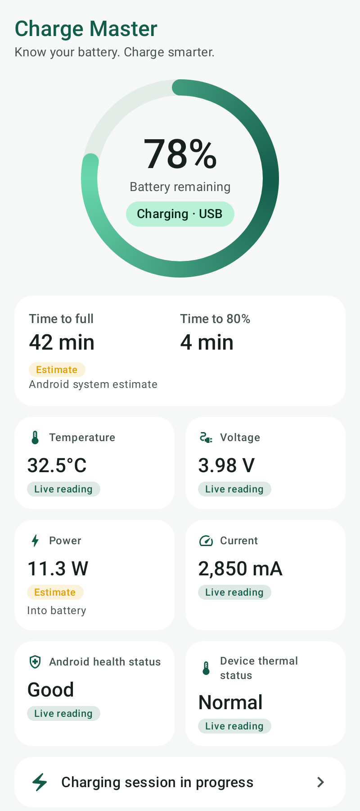
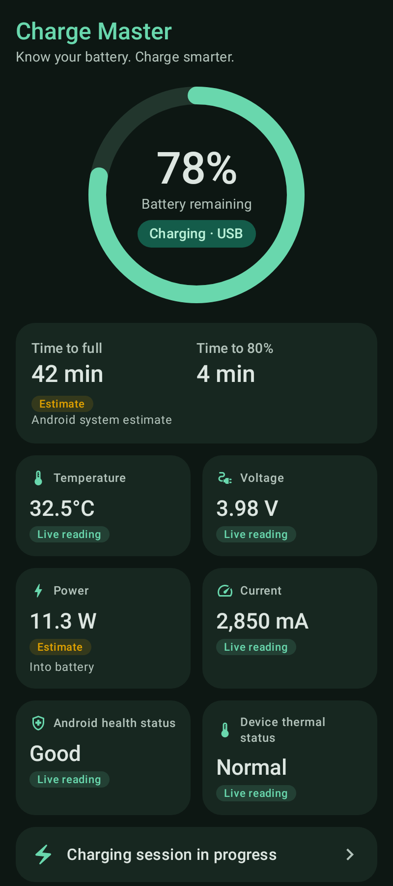
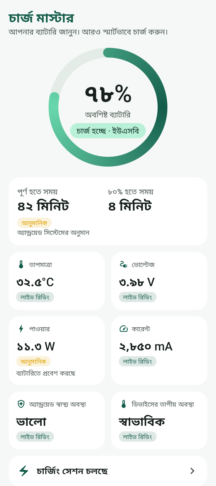
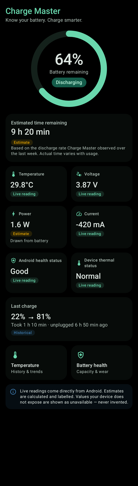

# Charge Master

**Know your battery. Charge smarter.**

Charge Master is an offline-first, privacy-first Android app for battery and charging analytics. It measures what Android exposes through public APIs, explains it clearly, and **never invents values**. When a sensor isn't available, the app says so.

| Light | Dark | বাংলা | AMOLED, on battery |
|---|---|---|---|
|  |  |  |  |

*(Rendered with Robolectric from test fixtures. On a real device, values come from the phone's sensors.)*

## Features

- **Live dashboard**: level, status, source (AC/USB/wireless/dock), temperature, voltage, current, estimated power (V × A), Android health status, thermal status, time to 80 % / full, and remaining time on battery.
- **Charging monitor**: live power chart, session duration, peak and average power, and an ETA. The ETA comes from Android's own estimate, or from the rate observed during the session, or from current and capacity, and the method used is labelled.
- **Adaptive dashboard**: choose which cards appear. While on battery, a "Last charge" card summarises the most recent session.
- **Charging sessions**: created automatically and stored in Room. Each session has start and end, levels, average and peak power, temperatures, source, and interruptions. Start and end are marked *precise* only when they were actually observed. Restarts and monitoring gaps are handled explicitly.
- **History and analytics**: a charging calendar (local calendar days with weekday labels), fastest and slowest sessions, average duration, a USB-vs-AC comparison, power vs. battery level, and temperature vs. power. Each session can be compared with your usual speed on the same source, and deleted.
- **Battery health**:
  - Shows Android's operational status, clearly separated from State of Health.
  - Estimates full-charge capacity from charge-counter deltas over charges that span at least 30 % of battery level. It flags fuel gauges whose counter is simply derived from the level.
  - Shows confidence levels, a health % only when you enter the design capacity from the manufacturer's spec, and a wear trend.
  - Shows the cycle count only when Android 14+ reports it.
- **Temperature**: history with gaps shown as gaps, min/max/average while charging vs. discharging, the recent trend, and °C/°F.
- **Charging Habit Score**: how often your recent sessions stopped near your charge target, avoided deep discharge, stayed below your temperature limit, and avoided very long charges. It uses your own thresholds and describes habits, not battery health.
- **Battery timeline**: level, temperature or voltage history, with gaps in monitoring shown as gaps.
- **Consumption insights**: discharge rate for 24 h, 7 d and 30 d, screen-on vs. screen-off drain, time charging vs. on battery, and monitoring coverage. Per-app usage is not shown, because public APIs don't give it to regular apps.
- **Smart alerts**: low battery, configurable 80 % / 90 % / 100 % thresholds, charging complete, started, interrupted, high temperature (with hysteresis), long charging, and unusually slow charging (needs at least 5 past sessions; not sent when the battery is hot). Each alert fires once per crossing. "Charging interrupted" is only sent when the charger is removed before the charge completes.
- **Diagnostics and report**: which sensors your device supports, how current is interpreted (learned unit and sign), monitoring coverage, and a plain-text report you can share. The report contains no identifiers.
- **Widgets**: three Glance widgets (Minimal, Detailed, Charging) whose layouts adapt to their size, plus a Quick Settings tile. They update only when a sample is recorded and never poll on their own.
- **Themes**: System, Light, Dark, AMOLED, dynamic color, high contrast, and reduced motion.
- **Localization**: English and Bangla (বাংলা), with an in-app language picker (Android 8+).

## What it deliberately does *not* do

- It doesn't stop or limit charging. Android doesn't allow apps to control charging, so the app only notifies you.
- No "battery repair", "calibration", RAM boosting or cooling claims.
- No root, no hidden or BatteryStats APIs, no fake health percentages, and no cycle counts derived from percentage changes.
- No INTERNET permission, no analytics, no ads.

## Tech stack

Kotlin 2.0 · Jetpack Compose + Material 3 · MVVM + Clean Architecture · Hilt · Room · DataStore · WorkManager · Glance · Coroutines/Flow · JUnit + Robolectric + Compose UI tests (81) · GitHub Actions CI.

Min SDK 26 (Android 8.0) · Target/compile SDK 35.

## Docs

- [Architecture](docs/ARCHITECTURE.md)
- [Build & test instructions](docs/BUILD.md)
- [Play Store release checklist](docs/PLAY_STORE_CHECKLIST.md)
- [Privacy policy (draft)](docs/PRIVACY_POLICY.md)
